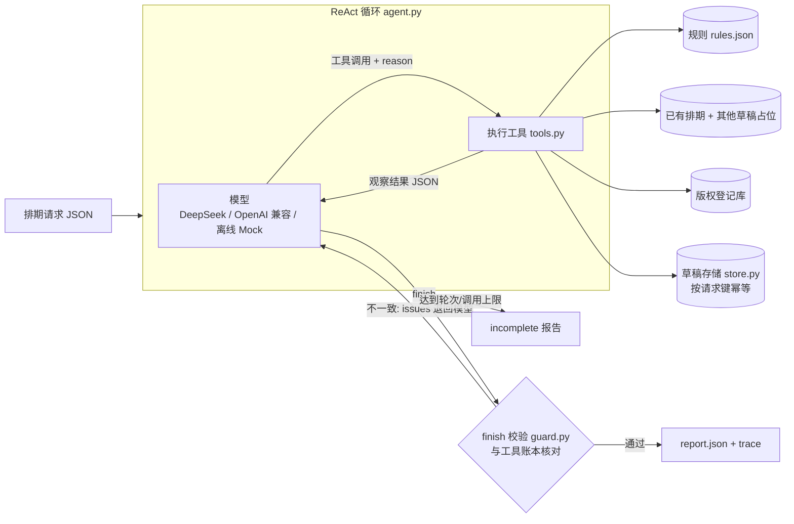

# 02 方案：调用流程、动态决策与技术取舍

## 1. 结构

循环（[agent.py](../src/scheduler_agent/agent.py)）**不含任何业务分支**。它只做四件事：调用模型、执行模型选中的工具、把结果原样回传、在上限或 finish 时停止。先查什么、要不要补查、选哪个替代时段、是否请求确认、是否阻断，都由模型根据工具返回决定。

## 2. 一次典型调用（参考实例 M01）

1. `get_material(M01)` → 元数据完整。
2. `check_rules(M01, 2026-11-03T18:00)` → `pass`。
3. `query_slots(douyin, 18:00)` → `occupied`（S-1001），备选 19:00、16:00、21:00…
4. 模型判断：19:00 是不早于原要求的最近空位，但它不在用户允许的范围内，属于改动硬性要求 → `save_schedule_draft([{slot: 19:00, confirmation_status: pending, note: …}])`。
5. 保存返回 `created`（草稿 D-…，修订 1，state=draft）。
6. `finish`：M01 建议 19:00、待确认、in_draft=true。校验通过后输出报告：`task_status=needs_confirmation`，`publish_status=not_published`。

真实模型（deepseek-flash）的完整记录见 [examples/runs/deepseek-flash/02_conflict/trace.md](../examples/runs/deepseek-flash/02_conflict/trace.md)。

## 3. 动态决策点

| 观察到的工具结果 | 模型可以选的动作 | 对应场景 |
|---|---|---|
| `check_rules` → `incomplete`，缺 `license` | **补查**：`lookup_license`；查到后重新 `check_rules`；查不到就标 `needs_info`，不排期 | 06 |
| `check_rules` → `block` | **阻断**：不查时段、不进草稿，给出风险原因 | 07 |
| `check_rules` → `review` | 排期，但 `pending` 等**人工复核** | 07 |
| `query_slots` → `occupied` / `held_by_draft` | **替代时段**：在用户窗口内选 → `not_required`；窗口外 → `pending` **请求确认** | 02、09 |
| 同批次两条要同一时段 | 让有窗口的那条在窗口内调整，没窗口的那条保留原时段；`also_taken` 告诉工具已规划的时段 | 09 |
| 请求带 `confirmations` 且与时段一致 | `confirmed` | 04 |
| 请求缺发布时间 | 不编造，列为待确认项 | 06 |
| 工具 `ok=false, retryable=true` | 重试（提示词限定最多再试 2 次）；仍失败如实报告 | 08、11 |
| `save` → `VALIDATION_FAILED` + issues | 按 issues 修正后再保存 | 单测 |
| `finish` → `REPORT_REJECTED` + issues | 修正结论或补做保存后再提交 | 单测 |

“05 更换占用时段并重复提交”展示了同一个请求在不同工具结果下走不同的路径：18:00 被占时走“替代 + 待确认”，18:00 空出来后走“原时段 + 无需确认”，而且两次落在同一份草稿上（修订号递增）。

## 4. 三层防线：关键缺陷靠代码拦，不靠提示词

| 风险 | 提示词 | 工具层（save_schedule_draft 二次校验） | finish 校验 |
|---|---|---|---|
| 越权发布 | 说明没有发布能力 | 没有任何发布工具；草稿 `state` 固定为 `draft` | 输出中出现“已发布/已上线/发布成功”就退回 |
| 虚报保存成功 | 失败如实报告 | 存储故障时不写入，返回 `saved=false` | `in_draft` 必须与最后一次**成功**保存一致；`draft_status` 由账本计算，不取模型的说法 |
| 擅自改期 | 改动须 pending | 时段≠原要求、不在 `acceptable_window`、请求里也没有对应确认时，必须 `pending`；没有用户确认时不能 `confirmed` | `confirmation_status` 必须与草稿一致 |
| 阻断素材进草稿 | block 不得入草稿 | 没跑过 `check_rules`，或结果是 block / incomplete，就拒绝保存 | `review_status` 必须与最近一次 `check_rules` 一致 |
| 时段冲突 | 同批次不撞时段 | 保存时重新查占用（已有排期、其他请求的草稿、同批次） | — |
| 改到其他日期后没复检 | 时段变了要复检 | 规则检查用的日期 ≠ 草稿日期时拒绝保存 | — |

报告里的字段分两类：
- **判断**（模型给出）：审核结论措辞、风险原因、建议时段、待确认项、总结。
- **事实**（由工具账本 `Ledger` 计算）：`draft_status`、草稿编号/修订号、`rule_findings`、`task_status`、`publish_status`。

## 5. 幂等与“一份草稿”

- **请求键**：有 `request_id` 就用它，否则用规范化后的 `items` 做哈希。`confirmations` 不参与计算，所以用户确认后再提交，更新的是同一份草稿。
- **草稿 ID**：`D-` + 请求键哈希，确定性生成。模型不能传入或伪造请求键，键由工具层根据原始请求计算。
- **内容哈希**相同 → `duplicate`，不写盘；内容不同 → `updated`，修订号 +1，并记录 `history`。
- 写入方式：先写临时文件，再 `os.replace` 原子替换。故障注入发生在写盘之前，失败时磁盘上没有部分写入。
- 其他请求的草稿也算占位（`held_by_draft`），避免两份草稿抢同一个时段；同一请求的草稿不挡自己。

## 6. 步数上限与未完成状态

- `max_turns`（默认 15 轮模型调用）、`max_tool_calls`（默认 40 次，含 finish）、`max_finish_rejections`（默认 2 次）。
- 触达任一上限，或模型接口报错时，返回 `task_status=incomplete` 和 `incomplete_reason`（`STEP_LIMIT_REACHED` / `TOOL_CALL_LIMIT_REACHED` / `REPORT_REJECTED` / `MODEL_ERROR`）。此时报告仍按账本如实给出已完成的部分，比如草稿是否已经保存。
- 网络层（429/5xx/超时）的指数退避重试只在 `llm.py` 的传输层做，与业务决策无关。

## 7. Trace

每一步记录：步号、轮次、工具、参数、返回摘要、完整返回（trace.json）、模型在 `reason` 里给的一句话依据、下一步动作。每个工具都有必填的 `reason` 参数，这样决策依据由模型自己写出来，不需要提交模型的内部思维过程。`messages.json` 保存原始对话（系统提示、请求、模型的工具调用、工具结果），供复核。

## 8. 技术取舍

| 选择 | 原因 | 代价 |
|---|---|---|
| 原生实现，不用 LangGraph / ADK 等框架 | 工具只有 6 个，主要难点是账本、二次校验和 finish 核对，需要精确控制；原生循环大约 120 行，每一步都能解释 | 没有现成的可视化、断点续跑和并发编排 |
| OpenAI 兼容的函数调用协议 | DeepSeek、Qwen、Kimi、OpenAI、vLLM 都能直接接入；原生 tool calling 比解析文本 JSON 更稳 | 只实现了这一种协议，没有实现 Anthropic 原生协议 |
| 只依赖标准库（urllib） | 克隆下来就能跑，评审环境不用装 SDK | 没有 SDK 自带的流式输出和类型提示 |
| 确定性规则引擎 + 模型做决策 | 合规判断要可复现、可追溯，不能让模型来判断“这算不算极限词” | 词表匹配会漏掉变体和语义违规（见 03 的限制部分） |
| JSON 文件存储 | 演示足够；原子写 + 幂等键已经体现了关键语义 | 没有并发锁；多进程同时写会互相覆盖 |
| `temperature=0` | 尽量可复现 | 模型在 temperature=0 时仍有非确定性（开发中实测出现过），所以评估以检查项为准，不比对逐字输出 |
| 离线 Mock = 手写规则策略 | 没有 API 也能跑通全部流程和测试 | **它不能证明真实模型的决策效果**，只能验证循环、工具、校验和落盘 |

## 9. 模块

| 文件 | 职责 |
|---|---|
| [agent.py](../src/scheduler_agent/agent.py) | ReAct 循环、上限、finish 校验回路 |
| [tools.py](../src/scheduler_agent/tools.py) | 6 个工具的 schema 与实现、故障注入、账本、保存二次校验、trace 摘要 |
| [guard.py](../src/scheduler_agent/guard.py) | finish 与账本核对、报告组装、`task_status` 计算 |
| [rules.py](../src/scheduler_agent/rules.py) | 规则引擎（R01–R07） |
| [slots.py](../src/scheduler_agent/slots.py) | 占用判断与替代时段 |
| [store.py](../src/scheduler_agent/store.py) | 幂等草稿存储 |
| [llm.py](../src/scheduler_agent/llm.py) | OpenAI 兼容客户端、`.env` 加载 |
| [mock_model.py](../src/scheduler_agent/mock_model.py) | 离线 Mock 策略 |
| [prompts.py](../src/scheduler_agent/prompts.py) | 系统提示词（业务边界，不预设任何具体素材的结论） |
| [evaluation.py](../src/scheduler_agent/evaluation.py) | 场景回放与验收检查 |
